# Routify

  

Share your phone's connection as a hotspot and send the traffic of connected devices through a VLESS or VMess server. Built for old rooted phones, but the proxy mode works without root.

> Status: early. Every release is tested on an Android 11 emulator (proxy mode) and is being tried on real devices. Root mode and the Wi-Fi Direct repeater cannot run on an emulator, so they have had less testing.

## What it does

The app has four tabs:

1. **Tethering**: start a Wi-Fi hotspot, a temporary hotspot, or a repeater (for phones that cannot run Wi-Fi and hotspot at the same time).
2. **Clients**: list connected devices and set a speed limit and a data limit for each one (needs root).
3. **VPN**: paste a `vless://` or `vmess://` link and connect. Powered by Xray-core.
4. **Settings**: theme (Auto, Dark, Light), VPN log detail, an error log with personal data hidden, and the option below.

### VPN modes

- **Root mode**: all TCP and DNS traffic from hotspot devices is redirected through the server. UDP is proxied too when the phone's kernel supports TPROXY.
- **Proxy mode (no root)**: Routify opens a local proxy (HTTP on port 8080, SOCKS on port 1080). Devices on your hotspot set it as the proxy in their Wi-Fi settings. Only apps that follow the Wi-Fi proxy are covered.
- The proxy has no username or password on purpose: anyone who can reach your hotspot network can use it.
- **Auto** (default) uses root mode when root works and proxy mode otherwise.
- **Settings > What Connect covers**: "Other devices only" (default) or "This device and other devices". The second option also puts this phone or tablet on the VPN, like a normal VPN app. Android asks for permission the first time. Routify itself is left out of the VPN so there is no loop.
- While the VPN is on, a notification keeps Routify running in the background.

### Untrusted server certificate

By default Routify checks the server's TLS certificate. If you run your own server and its certificate has expired or is self-made, you can turn on **Settings > Allow untrusted server certificate**. Routify then reads the certificate the server shows and pins it by its SHA-256 hash, so only that exact certificate is accepted. Leave it off unless you know why you need it.

## Screenshots

Taken on an Android 11 emulator with Routify v0.3.39.

<!-- screenshots:start -->
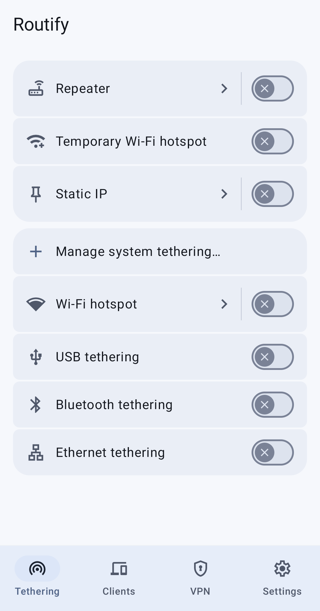
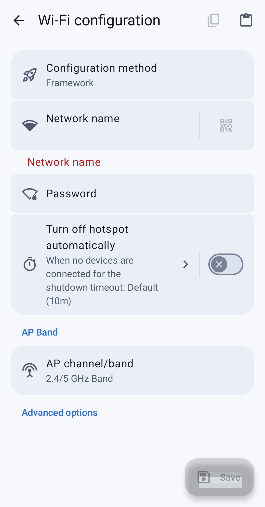
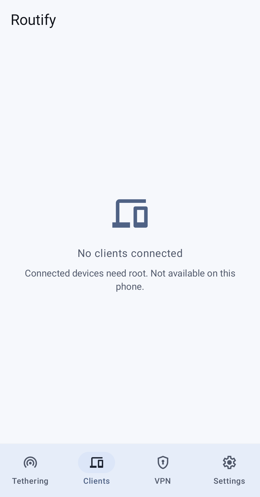
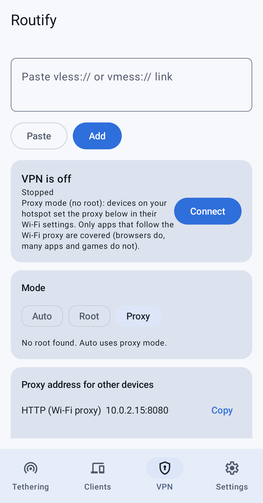
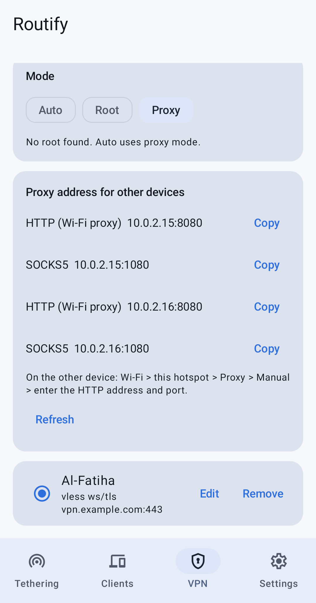
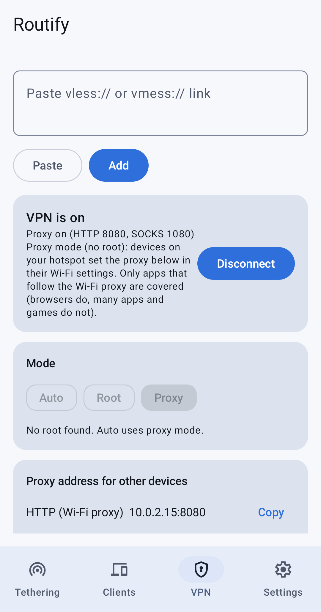
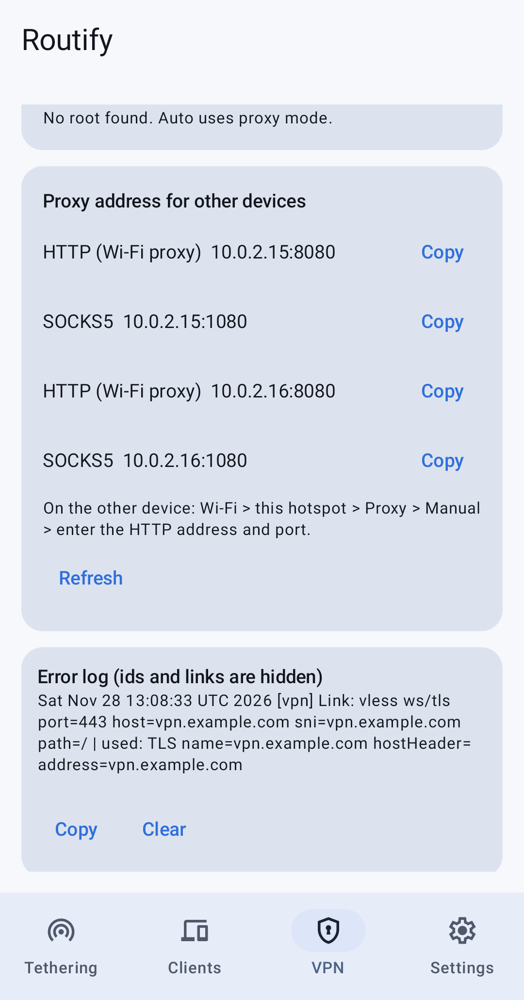

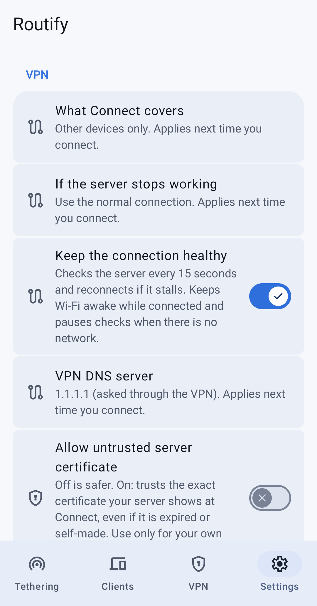
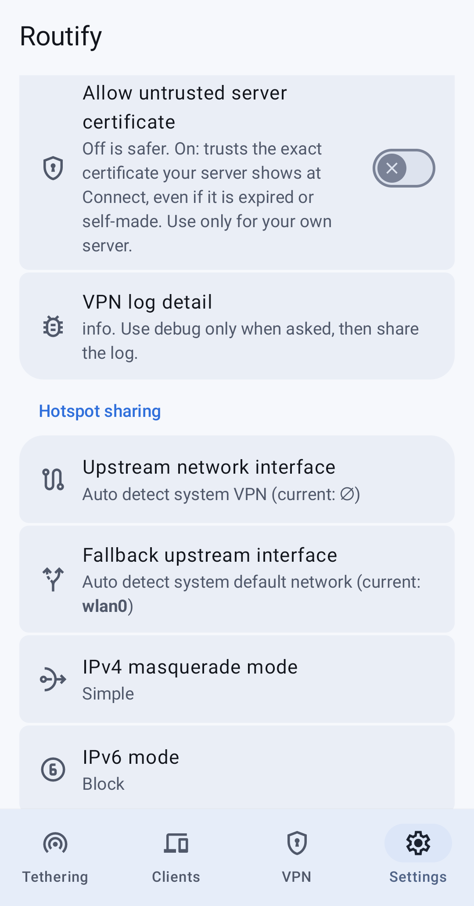
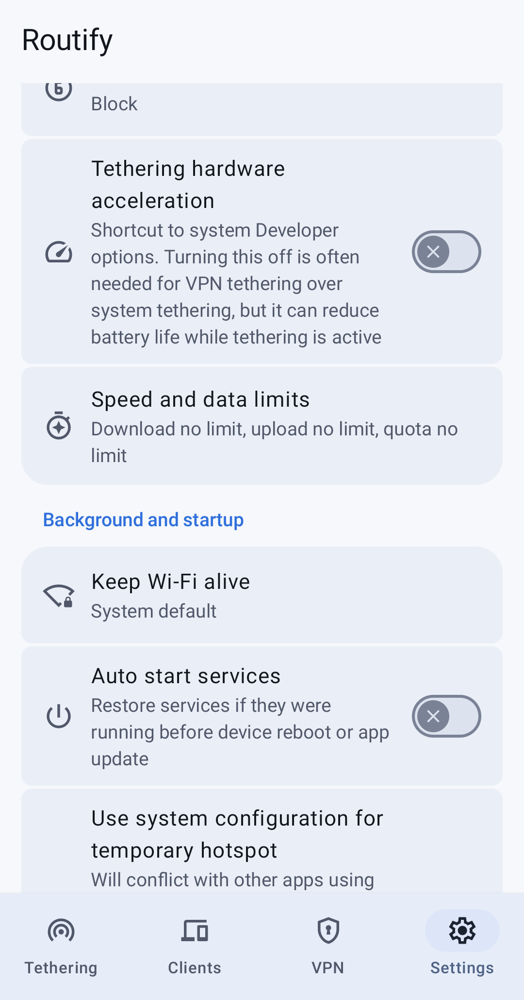
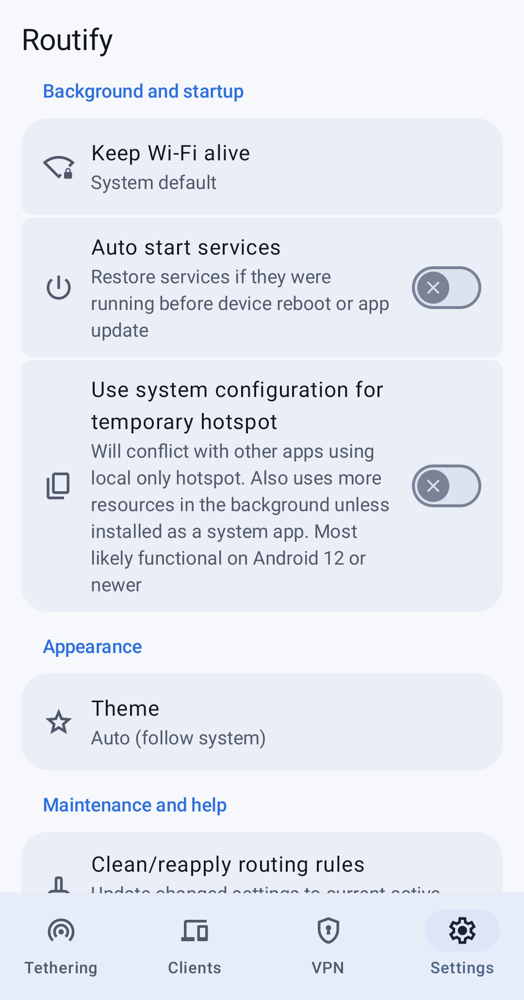
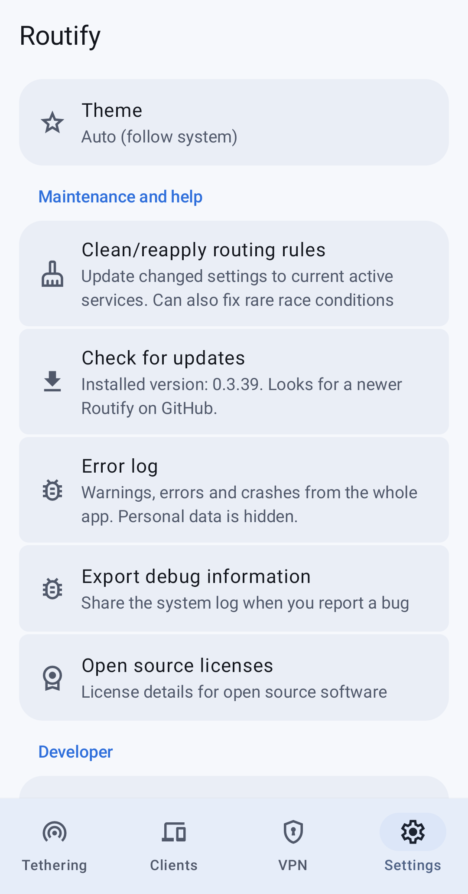
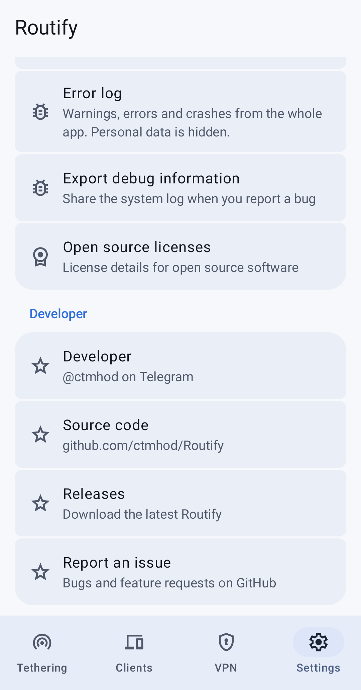
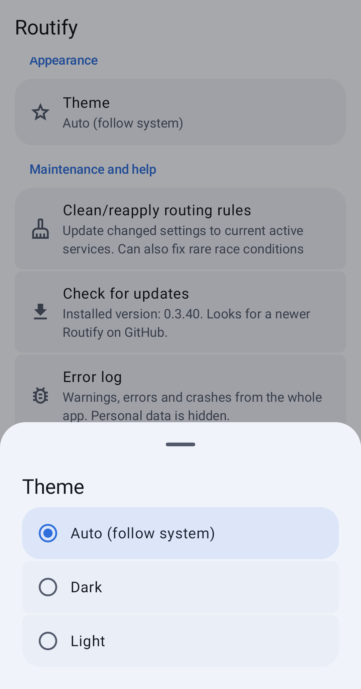
<!-- screenshots:end -->

## Requirements

- Android 10 or newer (API 29+)
- Root is needed for root mode, limits and some hotspot features. Proxy mode does not need it.

## Download

Get the latest APK from the [releases page](../../releases). Use the `universal` file if you are not sure. Releases are signed with a permanent key, so later versions install over earlier ones.

## Credits and license

Routify is licensed under the [Apache License 2.0](LICENSE).

Credits and third-party licenses are in [NOTICE](NOTICE).

